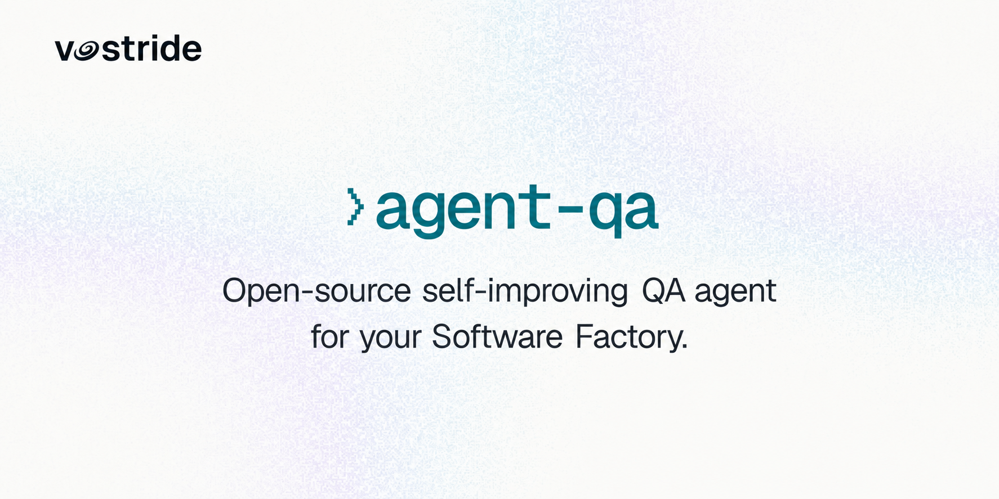
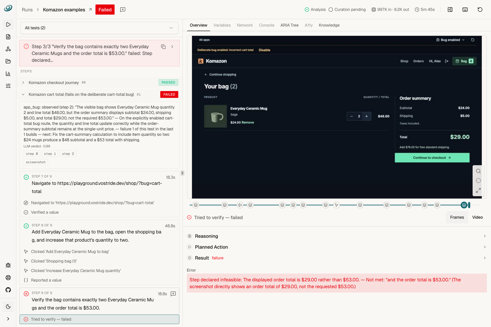
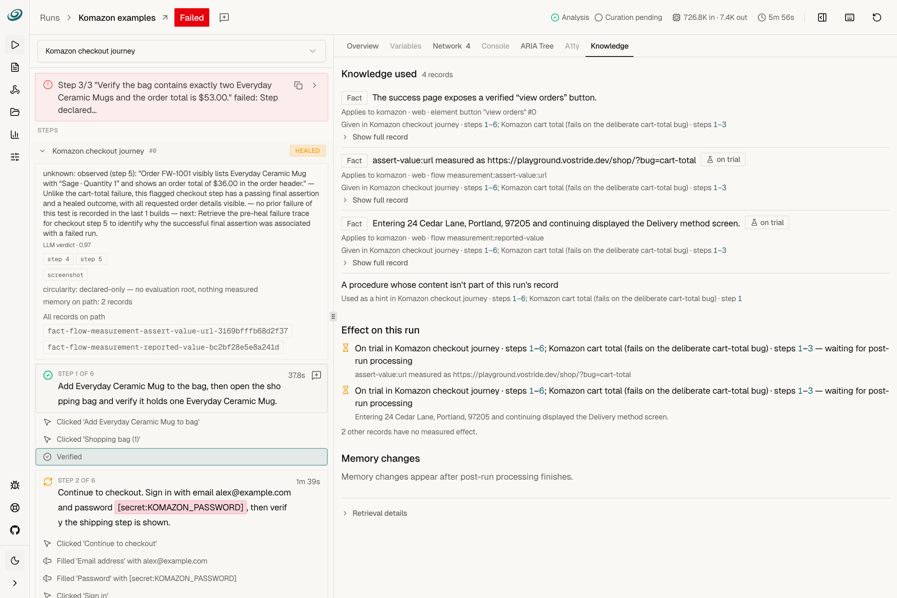
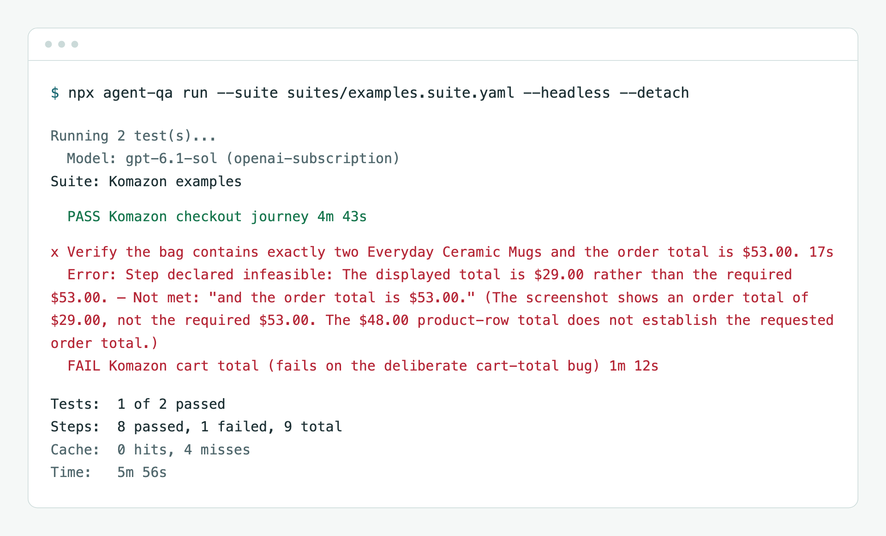

<picture>
  <source media="(prefers-color-scheme: dark)" srcset="docs/assets/readme/banner-dark.jpg">
  <source media="(prefers-color-scheme: light)" srcset="docs/assets/readme/banner-light.png">
  
</picture>

<p align="center">
  <strong>English</strong> · <a href="README.zh-CN.md">中文</a>
</p>

<p align="center">
  <a href="https://www.npmjs.com/package/agent-qa"></a>
  <a href="https://www.npmjs.com/package/agent-qa"></a>
  <a href="https://github.com/vostride/agent-qa/stargazers"></a>
  <a href="https://github.com/vostride/agent-qa/actions/workflows/ci.yml"></a>
  <a href="https://vostride.com/docs/agent-qa"></a>
  <a href="LICENSE.md"></a>
</p>

<p align="center">
  <a href="https://vostride.com/agent-qa">Website</a> · <a href="https://vostride.com/docs/agent-qa">Docs</a> · <a href="https://vostride.com/demo/agent-qa">Demo</a> · <a href="https://vostride.com/blog">Blog</a> · <a href="https://vostride.com/changelog">Changelog</a>
</p>

**Your AI QA engineer, with memory.** Describe a user journey in plain language. agent-qa tests it on web, Android or iOS and keeps the evidence. Use the CLI, the dashboard, or your coding agent through MCP and skills.

- **memidex:** remembers facts and working procedures as reviewable files in your repository.
- **Self-improvement:** validates lessons from runs, retires stale knowledge, and uses your feedback to correct mistakes.

| Benchmark | Rank | Published result |
| --- | --- | --- |
| [AndroidWorld](https://vostride.com/benchmark/android-world) | **#1** | **100% pass@1** (116/116 tasks) |
| [AppControlBench](https://vostride.com/benchmark/app-control-bench) | **#1** | **99.6% completion** (114.5/115 points) |

Read the full benchmark reports, with run evidence and methodology, on [our blog](https://vostride.com/blog). Both used gpt-6-sol with memory and self-improvement off; AppControlBench gives half credit for partial completion.

## See it in action

**Inspect a failure.** The demo catches a cart showing $29 instead of $53, with the failed step and its screenshot side by side.

<picture>
  <source media="(prefers-color-scheme: dark)" srcset="docs/assets/readme/evidence-dark.png">
  <source media="(prefers-color-scheme: light)" srcset="docs/assets/readme/evidence-light.png">
  
</picture>

**See what memory contributed.** Inspect the knowledge supplied to a run and trace it back to the steps that used it.

<picture>
  <source media="(prefers-color-scheme: dark)" srcset="docs/assets/readme/knowledge-dark.png">
  <source media="(prefers-color-scheme: light)" srcset="docs/assets/readme/knowledge-light.png">
  
</picture>

**Run from your terminal.** Real output from the demo suite: checkout passes; the deliberate cart-total bug fails.

<picture>
  <source media="(prefers-color-scheme: dark)" srcset="docs/assets/readme/cli-dark.png">
  <source media="(prefers-color-scheme: light)" srcset="docs/assets/readme/cli-light.png">
  
</picture>

## Get started

Requires Node.js 24+.

```sh
npm install -D agent-qa
npx agent-qa init
```

Follow the [quickstart](https://vostride.com/docs/agent-qa/quickstart) to connect a model and run the demo, or [set up with your coding agent](https://vostride.com/docs/agent-qa/agent-quickstart).

> [!NOTE]
> Early stage. Expect bugs. [Report an issue](https://github.com/vostride/agent-qa/issues) when something breaks.

## License

[Functional Source License (FSL-1.1-ALv2)](LICENSE.md).
